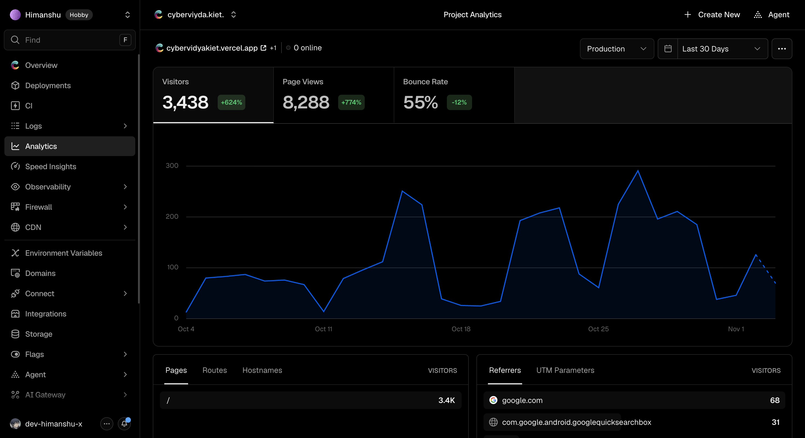

# CyberVidya Attendance Viewer

A fast, installable web dashboard for KIET (Krishna Institute of Engineering and Technology) students to check **CyberVidya** attendance without fighting the official ERP UI — overall percentage, per-course breakdowns, a calendar view, and "what happens if I skip class tomorrow" projections, all in one place.

> **Personal project, not affiliated with CyberVidya.** Your credentials go straight from your browser to the official CyberVidya API — this app has no backend and never sees or stores them on a server. See [Privacy & Disclaimer](#privacy--disclaimer).

<!-- PROJECT USAGE STATS: keep this section permanently. Do not remove. -->
## Usage

Figures from Vercel Analytics for the last 30 days (4 October 2026 to 3 November 2026), production site only:



| Visitors | Page views | Bounce rate |
| --- | --- | --- |
| **3,438** (up 624%) | **8,288** (up 774%) | **55%** (down 12%) |

Changes are compared with the previous 30 days.
<!-- END PROJECT USAGE STATS -->

## Features

### Login
- **Username + password + OTP** — the standard flow: submit your University Roll Number and CyberVidya password, then verify the OTP sent by CyberVidya to finish logging in.
- **Remember me** — optionally saves your username and password locally (cookies) so the credentials form is pre-filled next time; you still complete OTP verification.
- **Browser extension auth bridge (optional)** — the *Kiet Auth Bridge* extension (Chrome/Edge/Brave and Firefox, desktop + Firefox Nightly on Android) connects the app to your active CyberVidya session. The app detects whether the extension is installed and nudges you to update it if it's running an outdated version.
- Session token is stored in a cookie for 7 days; if the ERP rejects it (expired/invalid), the app clears it automatically and drops you back to login with your saved credentials pre-filled.

### Dashboard
- **Profile header** — time-aware greeting, name, registration number, branch, section, degree, and semester at a glance.
- **Overall attendance meter** — a circular progress ring showing your combined attendance percentage across all courses, color-coded (good / at risk / critical).
- **Adjustable target percentage** — drag a slider (60–100%) to set your personal attendance goal; every projection, badge, and color in the app recalculates against it and the choice is remembered for a year.
- **Attendance projections** — for your overall total and for every course, the app tells you either how many more classes you can safely miss or how many you need to attend next to hit your target.

### Courses
- **Card view** — every course as a card, broken down by component (Theory/Lab/Tutorial etc.), each with a progress bar, present/total count, and its own miss/attend projection.
- **Calendar view** — a month-by-month grid with a present/absent chip on every day that had classes, a monthly attendance ring, and month navigation (with a "jump to today" shortcut). Click any day to see every class held that day and how you were marked.
- **Daywise attendance modal** — click into any course component to see a full lecture-by-lecture history (date, day, time slot, and PRESENT/ABSENT/ADJUSTED status).
- **Search** — filter courses by name or code from the header search bar, live.

### Planning ahead
- **Today's Classes** — your schedule for today with each class's live attendance status as it gets marked.
- **Weekly "what-if" projection** — a full week's timetable grouped by time slot; click any upcoming class to mark it as "planning to miss" and watch your projected attendance percentages update instantly across the dashboard, without touching your real data.

### Quality of life
- Toast notifications for errors (expired session, failed requests, etc.).
- Skeleton loading states everywhere data is still fetching.
- Fully responsive layout with a collapsible sidebar nav on mobile.
- Installable as a PWA (`manifest.webmanifest`) for an app-like experience on your home screen.
- Terms of Service / Privacy Policy page built into the app.

## How it works

The app connects to CyberVidya for you, with no setup needed. Installing the optional *Kiet Auth Bridge* browser extension is not required.

Your password is AES-encrypted client-side before it's sent to CyberVidya's own login endpoint, and CyberVidya issues the session token used for every subsequent request.

## Tech stack

- **React 19 + TypeScript**, built with **Vite** and the SWC plugin
- **TanStack Query** for data fetching/caching
- **React Hook Form + Zod** for form state and validation
- **Sass** for styling (a custom "brutalist" design system — see `src/styles/`)
- **js-cookie** for client-side persistence, **crypto-js** for password encryption, **axios** for HTTP
- **Biome** for linting/formatting, **Husky + lint-staged** for pre-commit checks
- **Bun** as the package manager and script runner
- **Vercel Web Analytics**

## Project structure

```
src/
├── api/            # axios calls to CyberVidya (auth, attendance, schedule) + base URL/mode config
├── components/
│   ├── attendance/ # dashboard: Profile, OverallAtt, CourseCard, CalendarView, Daywise, TodayClasses, Projections
│   ├── auth/       # LoginForm, Terms & Privacy page
│   ├── docs/       # extension install instructions page
│   ├── layout/     # header, footer, extension-update banner
│   └── ui/         # buttons, cards, modal, badges, toasts, skeletons
├── hooks/          # auth token + target-percentage React contexts, toast hook
├── lib/            # attendance projection math, schedule/date helpers, query client
├── queries/        # TanStack Query hooks per endpoint
├── styles/         # Sass design system
└── types/          # API response types + app-wide constants

extension/
├── chrome/         # Manifest V3 "Kiet Auth Bridge" extension
└── firefox/        # Firefox build of the same extension
```

## Getting started

Requires [Bun](https://bun.sh).

Clone the repository:

```sh
git clone git@github.com:dev-himanshu-x/Attendance-cybervidya.git
cd Attendance-cybervidya
```

Install dependencies:

```sh
bun install
```

Run the dev server:

```sh
bun run dev
```

Type-check and build for production:

```sh
bun run build
```

Lint and format:

```sh
bun run lint
```

## Browser extension (optional)

The *Kiet Auth Bridge* extension is not required to use the app, but gives a more direct connection. It's built straight from `extension/chrome` and `extension/firefox` and packaged into release assets (`chrome.zip`, `firefox.xpi`) by the `Release Extension` GitHub Actions workflow whenever a `v*` tag is pushed. In-app, `InstallExtensionPage` walks through installing it on Chrome/Edge/Brave, Firefox, and Firefox Nightly on Android, and `ExtensionUpdateNotice` warns you in-app if your installed copy is older than `REQUIRED_EXTENSION_VERSION` (`src/types/constants.ts`).

## Privacy & Disclaimer

- This is a **personal, non-commercial project** — not an official CyberVidya product, and not endorsed by KIET or CyberVidya.
- No server-side storage: credentials are sent directly to the official CyberVidya API and never touch a server owned by this project.
- Anything persisted locally (session token, saved username/password if "remember me" is checked, target percentage) lives only in your browser's cookies.
- Full terms are available in-app on the Terms of Service & Privacy Policy page (`src/components/auth/TnC.tsx`).

## License

For personal/educational use.
